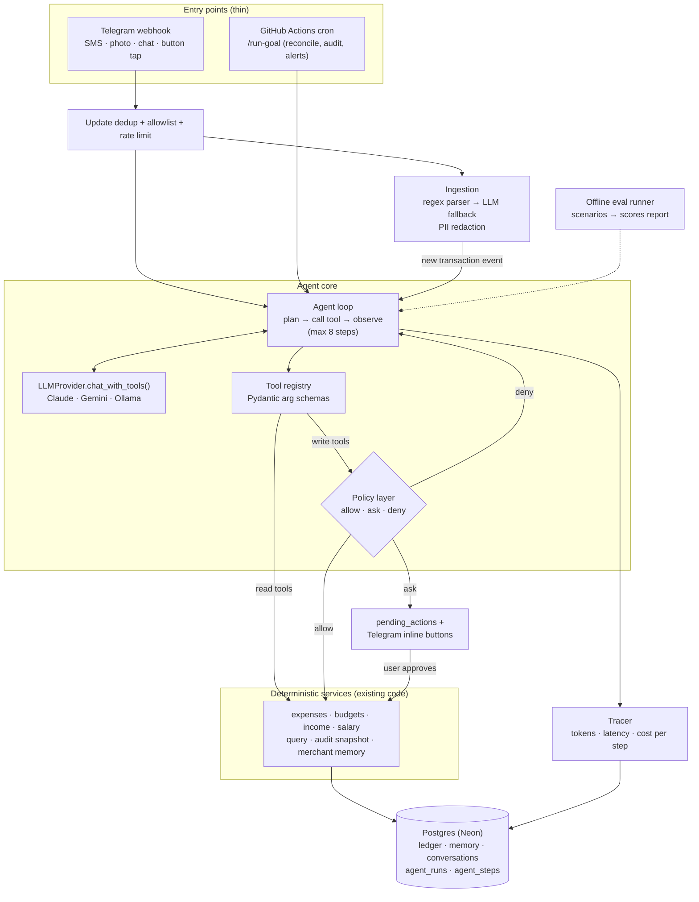

# PocketAuditor v2 — Agent Design

Status: **Proposed** · Scope: turn the fixed reconcile/audit pipelines into one
tool-using agent, without losing the guarantees the current code already gives.

## 1. Goals and non-goals

**Goals**

1. One agent loop that handles three triggers: a forwarded SMS/photo
   (reactive), free-form chat (conversational), and cron goals (proactive).
2. The model chooses *which* tools to call; code decides *whether* a write is
   allowed (policy layer). The model never does arithmetic.
3. Every agent run is traced (steps, tokens, latency, cost) and the whole
   system is measured by an offline eval suite.
4. Fix the known correctness/security bugs first, so the agent is built on a
   sound base.

**Non-goals (deliberately out of scope)**

- Multi-agent orchestration, LangChain/LangGraph/CrewAI, a separate vector DB,
  fine-tuning, a web UI. Each adds moving parts without a measured need.
- Replacing the deterministic parts. Regex parsing, all money math, budget
  alerts, and mid-month alerts stay as plain code — the agent calls them as tools.

## 2. Guiding principles

| Principle | What it means in code |
|---|---|
| Deterministic where it must be exact | Totals, dates, deltas come from SQL/Python, returned by tools. The model only phrases them. |
| The model proposes, policy disposes | Every write tool call passes `policy.check()` before it runs. |
| Humans approve risky writes | Low confidence, unseen ids, large amounts, duplicates → `ask_user` with inline buttons. |
| Boring infrastructure | Reuse Postgres for everything (state, memory, traces). No new services. |
| Measure before adding complexity | Embeddings, a bigger model, or more tools are added only when an eval shows the gap. |

## 3. Architecture



### Request flow (example)

```
"Swiggy charged me twice yesterday, fix it"
 1. search_transactions(merchant="swiggy", range="yesterday")   read  → 2 × Rs.450
 2. find_duplicates(...)                                         read  → pair found
 3. mark_duplicate(txn_id=…)                                     write → policy: ASK
 4. Telegram: "Mark Rs.450 Swiggy (2nd) as duplicate? [Yes] [No]"
 5. user taps Yes → action executes → agent run resumes → replies with result
```

## 4. Components

### 4.1 Agent loop (`app/agent_core/loop.py`)
- Hand-written, ~150 lines. Input: a *goal* (user message, SMS event, or cron
  goal) plus context (user, date in user's timezone, short history).
- Loop: call model with tools → execute returned tool calls → append results →
  repeat until the model answers in text or a stop condition hits.
- Stop conditions: final answer, `max_steps=8`, per-run token budget, a tool
  needing approval (run is **paused** and persisted, resumed on button tap).
- All tool errors are returned to the model as tool results, never raised out
  of the loop. Provider errors become `LLMDecisionError` (fixes the current
  leak of raw SDK exceptions).

### 4.2 LLM provider (`app/llm/`)
- Add one method to the existing `LLMProvider` Protocol:
  `chat_with_tools(messages, tools) -> AssistantTurn` where `AssistantTurn`
  is our own Pydantic model (`text | tool_calls`, `usage`). Each provider maps
  its native tool-calling format to it — callers never see vendor types.
- Keep existing structured-output methods (`parse_transaction`,
  `extract_receipt`) — single-shot extraction doesn't need an agent.

### 4.3 Tools (`app/agent_core/tools/`)
Each tool = a plain async function + a Pydantic args model (schema generated,
never hand-written) + metadata `kind: read|write`.

| Read (run freely) | Write (go through policy) |
|---|---|
| `search_transactions`, `search_expenses` | `link_transaction` |
| `find_match_candidates`, `find_duplicates` | `log_expense` |
| `get_budget_status`, `get_spend_summary` | `recategorize_expense` |
| `get_income_summary`, `get_month_snapshot` | `mark_duplicate` |
| `recall_merchant` | `set_budget`, `remember_merchant` |
| | `ask_user` (always allowed — it *is* the safe path) |

### 4.4 Policy layer (`app/agent_core/policy.py`)
Pure function, fully unit-tested: `check(call, run_ctx) -> Allow | Ask(reason) | Deny(reason)`.
Rules (generalizing today's `_apply_guard` / `_apply_duplicate_guard`):

1. Any id in the args must have appeared in an earlier tool result in this
   run → otherwise **Deny** (hallucinated id).
2. Category must normalize to the canonical list → otherwise **Ask**.
3. Model-stated confidence < threshold → **Ask**.
4. Possible duplicate charge, or amount > `auto_write_limit` → **Ask**.
5. Records must belong to the requesting user → otherwise **Deny**.
6. Destructive actions (delete, overwrite a user-set category) → always **Ask**.

### 4.5 Human-in-the-loop
- `pending_actions` table holds the proposed tool call, its reason, and the
  paused `agent_run_id`. Inline button callback `pa:<id>:yes|no`.
- Callback handler checks the action belongs to the tapping chat (fixes the
  current missing ownership check), executes or rejects, then resumes the run.

### 4.6 Memory
- **Short-term:** last 10 turns from `conversation_messages`.
- **Long-term:** merchant memory upgraded from exact match to fuzzy match with
  Postgres `pg_trgm` similarity (`ZOMATO LTD` ≈ `zomato@hdfc`).
  Embeddings/pgvector only if evals show trigram matching is not enough.

### 4.7 Observability
- `agent_runs` (goal, trigger, status, total tokens, cost, latency) and
  `agent_steps` (each model call/tool call with args, result summary, policy
  verdict, latency). A `/trace <run>` admin command prints a run.
- Prompts are versioned constants (`PROMPT_VERSION`) recorded on every run.

### 4.8 Safety and hygiene
- `ALLOWED_CHAT_IDS` allowlist + per-user daily LLM-call budget.
- PII redaction before any LLM call (mask account numbers, phones, UPI refs).
- Webhook: dedupe by `update_id`, ack Telegram fast, process in background.
- Per-user timezone (`users.timezone`, default `Asia/Kolkata`); one
  `today_for(user)` helper replaces every `date.today()`.

## 5. Technology decisions

| Area | Decision | Why | Rejected |
|---|---|---|---|
| Language / web | Keep Python 3.11 + FastAPI | Already works, typed, tested | — |
| Bot | Keep python-telegram-bot | Inline buttons = free HITL UI | Web UI (non-goal) |
| Agent framework | **Hand-written loop** | ~150 lines, full control, easy to explain in interviews, no hidden prompts | LangChain, LangGraph, CrewAI |
| Tool calling | Native tool/function calling of each provider, behind `LLMProvider` | Reuses existing provider boundary | Prompted JSON "ReAct" parsing (brittle) |
| Primary agent model | Claude (Sonnet-class) | Most reliable multi-step tool use | — |
| Free / cheap option | Gemini Flash-Lite (`-latest` alias) | Free tier, supports function calling | — |
| Local dev | Ollama `qwen2.5` 7B (tool-capable) | Free, offline; evals show its gap honestly | — |
| Database | Keep Postgres (Neon) + SQLAlchemy async + Alembic | One store for ledger, state, memory, traces | Redis, separate vector DB |
| Fuzzy memory | `pg_trgm` | Built into Postgres, no new infra | pgvector (add only if evals need it) |
| Tracing | Own `agent_runs`/`agent_steps` tables | Zero dependencies, queryable with SQL | Langfuse/LangSmith (can export later) |
| Evals | Own runner: JSONL scenarios + pytest-style scorers | Simple, versioned in git | Paid eval platforms |
| Scheduling | Keep GitHub Actions cron → secret-gated endpoints | Free, already in place | Celery / queue workers |
| Deploy | Keep Docker on Hugging Face Spaces | Already in place | — |
| Quality | Keep ruff + mypy + pytest in CI | Already in place | — |

## 6. Data model changes

| Table | Purpose |
|---|---|
| `users.timezone` (new column) | Correct "today" / month boundaries |
| `agent_runs` | One row per agent run: trigger, goal, status (`running/paused/done/failed`), tokens, cost, latency, prompt version |
| `agent_steps` | Ordered steps of a run: model turn or tool call, args, result summary, policy verdict |
| `pending_actions` | Proposed write awaiting user approval, linked to a paused run |
| `conversation_messages` | Short-term chat memory |
| `processed_updates` | Telegram `update_id` dedup |

Existing tables (`transactions`, `expenses`, `incomes`, `budgets`,
`salary_profiles`, `merchant_categories`, …) stay. `reconciliation_runs` and
`audit_runs` remain for history; new runs are traced in `agent_runs`.

## 7. Evaluation plan

- `evals/scenarios/*.jsonl` — 50–100 scenarios. Each: seed DB state, input
  (SMS / chat / goal), expected outcome (final ledger state, required/forbidden
  tool calls, whether approval should be requested).
- Categories: clean SMS, ambiguous P2P transfer, duplicate charge, salary
  credit, refund, OTP/promo (must be rejected), balance-first SMS, budget
  questions, multi-step chat requests, prompt-injection inside SMS text.
- Metrics: task success %, unsafe writes executed (target 0), unnecessary asks
  %, avg steps, tokens, cost and latency per task — per provider.
- `python -m evals.run --provider claude` writes `evals/results/<date>.md`.
  CI runs only a small, recorded (fake-provider) subset; full runs are manual.
- Baseline: run the **current pipeline** on the same scenarios first, so the
  agent's improvement is measured, not claimed.

## 8. Phased plan

| Phase | Work | Done when |
|---|---|---|
| 0. Foundations | Fix parser bugs (credit misread, balance amount, OTP), per-user error isolation in cron, provider error wrapping, `savings_rate` overflow, callback ownership checks, timezone, allowlist | Regression test per bug; all tests green |
| 1. Eval baseline | Scenario format, runner, scorers, 50+ scenarios, baseline report of current pipeline | Baseline numbers committed |
| 2. Agent core | `chat_with_tools` in 3 providers, tool registry, policy layer, loop, tracing tables | Reconcile goal runs through the agent; policy 100% unit-tested |
| 3. HITL + chat | `pending_actions`, pause/resume, conversational mode replaces `/ask` | Multi-step chat scenarios pass |
| 4. Proactive + memory | Cron goals (reconcile, audit, alerts) via agent; `pg_trgm` merchant memory | Eval report: agent vs. baseline, per provider |
| 5. Polish | README rewritten around results, architecture diagram, demo GIF | Resume bullets backed by real numbers |

## 9. Risks

| Risk | Mitigation |
|---|---|
| Agent loops or wastes tokens | `max_steps`, per-run token budget, traced cost |
| Model writes wrong data | Policy layer + HITL; evals track unsafe writes |
| Prompt injection via SMS text | SMS content passed as data, policy enforces rules regardless of model output; injection scenarios in evals |
| 7B local model too weak for tool use | Expected; evals quantify it; Gemini/Claude for real use |
| Scope creep | Non-goals list above; each phase has an exit criterion |
